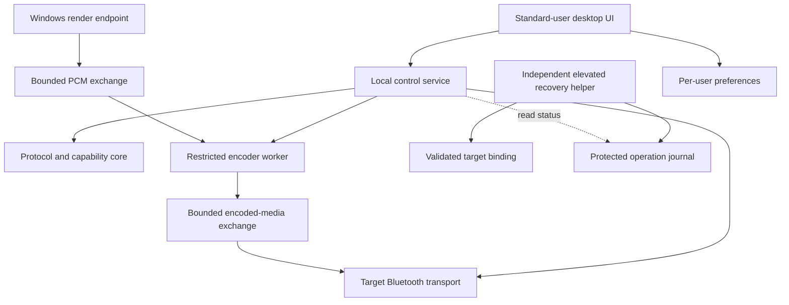

# Architecture

Status: proposed M0-WP02 design, 2026-10-30 (Asia/Calcutta). This document assigns responsibilities and describes logical contracts. No component, driver binding, codec, or recovery procedure has been implemented or validated. The [system design](15-system-design.md) owns lifecycle invariants; the [security controls](11-security.md) govern every boundary. [API/contracts](05-api-and-contracts.md), [storage](04-database-and-storage.md), and [UI/UX](02-ui-ux-design.md) refine this design.

## Scope and dependency direction

The first implementation path is a safe user-mode foundation, a dedicated recoverable lab, controlled-source SBC transport, Windows system audio, then LDAC. The desktop interface and stored preferences cannot establish that audio reaches a receiver. Q-001 through Q-006 remain feasibility gates in the [risk register](defect-risk-register.md).

The diagram expresses ownership and dependencies, not an agreed driver ABI or process-launch sequence. Ordinary playback has no network, hosted service, account, activation, expiry, or runtime AI dependency. REA remains optional development research tooling under SEC-009.

The protocol/capability core must be testable without a Windows device or privileged service. It accepts explicit bounded inputs and produces parsed values, validation results, or state transitions; it does not install drivers, open arbitrary paths, or infer codec availability from UI choices. Product capabilities are restricted to reviewed implementations enabled in the installed build.

## Component responsibilities

| Component | Owns | May request or observe | Must not own |
| --- | --- | --- | --- |
| Desktop UI | Presentation, edits, per-user preference persistence, accessible offline recovery entry point. | Authorized snapshots, explicit apply/stop, progress and sanitized diagnostics for its session. | Kernel handles, binding mutations, another session's state, or authoritative active codec. |
| Local control service | Authenticated session policy, one controller lease, selected target, ordered control state, worker supervision and authoritative snapshots. | Validated inventory, driver/worker status, protected recovery-status projection. | Arbitrary elevated execution, codec discovery from untrusted DLL paths, or assumed-success installation. |
| Protocol/capability core | Parsing and validation of permitted protocol fixtures, codec constraints, capability intersections and state rules. | Explicit specification/version and bounded caller input. | OS ownership decisions, device installation, user identity supplied in a message. |
| Encoder worker | Current stream's codec instance, partial-frame state, encoding and media packetization. | Narrow PCM/media handles and current negotiated configuration. | Control or install rights, unrelated device handles, general plugin loading. |
| Render endpoint component | Endpoint lifetime, PCM frame format and positions, bounded PCM handoff and endpoint-side underrun behavior. | Generation-scoped stream contract from control. | Codec policy, logs on its real-time path, or a claim that endpoint activity proves remote playback. |
| Bluetooth transport component | Validated target/channel ownership, negotiated transport limits, pending requests, completion/cancellation and removal cleanup. | Narrow control operations and generation-scoped media submissions. | Other paired devices, broad radio replacement, arbitrary user/kernel pointers. |
| Independent install/recovery helper | Package validation, exact target resolution, privileged operation lock, protected journal, observed binding and explicit intended-owner updates. | Live OS inventory, reviewed package/operation allowlist, scoped elevated action. | Codec preferences, background rebind, general commands/registry editing, unrelated package removal. |
| Diagnostics/export layer | Bounded structured records and user-initiated redacted local exports. | Approved snapshots/counters and sanitized helper progress. | Routine PCM/encoded audio, secrets, unrestricted dumps, automatic uploads. |

The endpoint and transport may become separate drivers or another reviewed packaging arrangement. The service identity, worker restrictions, driver-interface ACLs and media-handle delegation require implementation evidence. Do not assume that running the whole product as administrator solves those questions.

## Separate control, media, and privileged operations

**Control:** local versioned named pipes carry bounded low-rate requests and snapshots. Explicit access rules, Windows peer authentication, server validation, remote-client rejection, deadlines and quotas implement SEC-001/002. Client-supplied SID, session number, display name or `targetId` never establishes authority. Control responses cannot block a kernel callback or media producer.

**Media:** PCM and encoded frames use separately reviewed bounded exchanges. Every submission is associated with a current stream, valid format, ownership state and negotiated transport limits. Backpressure cannot allocate indefinitely, silently discard arbitrary encoded bytes or stretch latency without bound. M3/M4 select mechanics after the relevant experiments; JSON control pipes, arbitrary pointers and presumed zero-copy are not the design contract.

**Privileged operation:** install, update and restore run through the independent helper. The service can report that such an operation is needed; it cannot convert an ordinary apply into a binding change. A helper-owned exclusion mechanism prevents binding changes while a target has active control/media resources. If the service is absent, the helper must still establish a tested quiescent state from live OS/driver state before mutation. The exact lock and crash-recovery protocol are M3-WP01 deliverables, not an assumed process-local mutex.

Every boundary revalidates inputs. Authentication does not validate a buffer, and a successful lower-level call does not prove final target state. Privileged target resolution uses trusted live identifiers and protected mappings, never a friendly device name or caller-selected path.

## Identity, ownership and ordered state

The following logical identifiers must agree with the contracts document; their representation and numeric limits are fixed before implementation.

| Identifier | Owner and purpose | Invalidation rule |
| --- | --- | --- |
| `serviceEpoch` | Service instance identity, fencing all volatile control state. | A service restart creates a fresh epoch; old requests/events cannot act on the new instance. |
| `targetId` | Opaque local reference to a resolved target. | Revalidate its OS mapping on reconnect/binding changes; ambiguous or missing mappings require rediscovery. It is never an authorization token. |
| `controllerLease` | Service-owned exclusive control bound to a verified Windows user and interactive session. | Release, logoff, service loss or enforced policy invalidates it after cleanup. Knowing its identifier grants no authority. |
| `connectionGeneration` | Current Bluetooth connection/capability generation. | Disconnect, removal or suspend invalidates channel work and capabilities; reconnect requires fresh discovery. |
| `streamGeneration` | Current PCM/encoder/media lifetime within a connection. | Stop/start, format reconfiguration or stream fault invalidates old frames, clocks and completions. |
| `settingsRevision` | UI-owned saved preference version captured with an explicit apply. | Storage rejects conflicting revision/content writes. The service uses the submitted revision only for correlation; saving does not make it active. |
| `requestId` / `operationId` | Request correlation and asynchronous operation identity within the appropriate authority. | Retries must resolve prior outcomes or fail safely; identifiers do not make a repeated side effect safe by themselves. Helper operations survive service restarts in the protected journal. |
| `snapshotSequence` | Ordering of decision-relevant authoritative state within an epoch; high-rate telemetry has separate ordering. | A gap, stale event or new epoch requires a full authorized snapshot before further mutation. |

The service serializes mutations for the selected target. Multiple windows belonging to an eligible owner can inspect authorized state, but conflicting control writes are checked against current ownership, `snapshotSequence` and generations. The UI persistence component separately checks preference revision/content conflicts. Another session receives only the minimum unavailable/busy result; it cannot inspect the owner's audio, settings or detailed diagnostics. Fast user switching must not seize an existing lease. Explicit release/logoff stops the old stream and clears its handles before reassignment.

A UI connection is not the controller lifetime. Closing or crashing a window leaves healthy playback running under the service-owned lease. A returning eligible UI authenticates again and resynchronizes from a full snapshot. Service loss terminates orphaned worker/driver leases; restarting the service never adopts surviving handles by numeric ID. Reacquisition follows cleanup, fresh identity checks and the authorized session policy.

## Requested, active and observed state

The UI owns unsaved edits and persisted requested settings. V1 requires successful Save before Apply; the UI checks the saved revision and complete content before submitting that request. The service retains only the captured submitted request and its revision, current operation, negotiated active settings, last verified historical configuration, and observation freshness. It does not read preference files or observe later Saves. A later Save cannot alter an accepted operation; the UI shows any unapplied saved differences separately. Remote-advertised capabilities, build-enabled implementations and reviewed distribution eligibility remain separate inputs. An unavailable query is unknown, not an empty capability set.

An explicit apply validates ownership, target, expected service snapshot/generations and fresh capability intersection before touching a running stream. The submitted `settingsRevision` is correlation, not proof of storage freshness or a reason to reject a request because of an unseen local Save. Invalid requests leave existing playback alone. Once a valid change enters stop/reconfigure, a later negotiation failure leaves playback stopped or faulted with a reason; it cannot relabel the prior historical settings as active or silently select another codec. A user can explicitly choose SBC. Manual quality is the v1 policy; automatic quality adaptation remains a separate gated feature under RQ-023.

Snapshots distinguish link connectivity, A2DP readiness, endpoint availability and observed stream progress. Windows PCM format, observed A2DP/HFP profile, negotiated Bluetooth format, selected microphone, intended owner and observed transport owner are independent fields with freshness/source information. Unsupported firmware-owned USB transport is an explained state. Missing telemetry or a general decoder inventory does not establish a codec or fault cause.

Routing information includes current endpoint identity, any validated prior-to-current mapping and whether observed default/per-app/DSP attachments may need attention. Identity preservation remains an M4 experiment. A changed identity invalidates stale endpoint handles and prompts scoped guidance; the product does not rewrite third-party app/EQ/APO configuration or silently disable microphones.

## Resource ownership and failure handling

| Resource | Owner | Required release/failure behavior |
| --- | --- | --- |
| Controller lease and control operations | Service | Stop on release/logoff; bound pending work; reject stale epoch/snapshot/generation; disconnect slow clients without blocking audio. |
| Codec instance, partial PCM/encoded frame and media clocks | Worker for one stream | Clear at a valid stop boundary; a new stream starts fresh even on the same Bluetooth connection. Preserve channel meaning through tested format conversion. |
| PCM exchange and endpoint context | Endpoint and explicitly designated buffer owner | Track producer/consumer lifetime; stop submission before detach; no reuse while an outstanding reader or completion can reach it. |
| Bluetooth channels and pending I/O | Transport | Cancel/drain on stop/removal; complete each operation at most once; stale callbacks can finish cleanup but cannot update new stream state. |
| Privileged operation and journal | Helper | Persist intent before side effect, record observed result, recover uncertain completion through live inspection; never blindly replay a PnP change. |
| Diagnostic event queues and export files | Diagnostics layer | Drop/count excess diagnostic events instead of blocking audio; bounded files, privacy rules and explicit export lifecycle. |

Cleanup timeout is a fault, not permission to free live resources. Isolate unreleased contexts until their owners are quiescent, block conflicting work and expose recovery state. Worker hang/crash stops the affected stream; restart is permitted only after bounded cleanup. Sleep/resume invalidates pre-suspend channel assumptions and refreshes binding/capabilities. HFP transitions respect Windows ownership and produce an honest stopped/suspended/unsupported status; simultaneous high-quality stereo and Classic microphone operation is not promised.

Track boundaries and application handoff must not force a radio reconnect when the negotiated format remains valid. They do require the stream lifecycle to discard stale partial frames and reset clock/sequence state according to the pinned protocol. Format changes use explicit stop/reconfigure. M4/M7 validate known left/right fixtures, repeated transitions and independent input devices under RQ-019/020/025.

## Binding, operation progress and independent recovery

The machine-protected record separates **intended owner**, **last observed binding**, **pre-change binding/package identity**, and **current operation outcome**. Intent is updated only for an explicit scoped operation; a preference edit, UI restart, expiry timer or discovered mismatch cannot authorize a rebind. Drift moves the target to a diagnostic/recovery state until a fresh authorized action resolves it.

Before a privileged change, capture the target and relevant non-target endpoint baseline and validate the exact staged package. Report a helper-owned `operationId`, current stage, last durable progress, cancellation availability, and whether reboot or recovery is pending. A watchdog reports overdue work against stage-specific measured deadlines. It does not invent percentage completion, kill an in-flight PnP call or label an uncertain result rolled back.

Cancellation is requested and acknowledged only at tested safe boundaries. UI closure detaches the observer; it does not cancel a privileged operation. Reopening the UI or using the standalone helper reconstructs progress from protected journal plus current OS state, independently of the ordinary service. Unknown/corrupt/newer journal state blocks unsafe mutation and leads to version-aware recovery guidance.

Restoration aims at the recorded previous Windows path and verifies actual target playback, non-target outputs/capture, and any required post-reboot checks. A successful installer exit alone is incomplete recovery evidence. Offline instructions, recovery media and private access to required recovery material are M2 prerequisites; this design does not provide a demonstrated recovery path today.

## Experiment and implementation gates

| Owning package | Must settle before dependent implementation | Required artifact |
| --- | --- | --- |
| M1-WP01 | Exact toolchain/OS targets, protocol revisions, encoder candidates and dependency provenance. | Pinned inventory and review; no license/support inference from a library name. |
| M1-WP02 | Executable core/control schemas, parser/resource bounds, malformed/stale/session fixture cases. | Reviewed fixture baseline and reproducible user-mode results. |
| M3-WP01 | Per-target binding/channel ownership, restricted service identity, helper exclusion/journal protocol and operation deadlines. | Lab ADR and successful independent restoration under SEC-001/002/003/006. |
| M3-WP02 | AVDTP transactions, remote capability evidence, observable counters and transport limits. | Negotiation/timeout fixtures and actual observation inventory. |
| M4-WP01 | Endpoint mechanics, PCM exchange, format/channel rules, timing and buffer ownership. | Measured endpoint/buffer ADR; reviewed interface/lifetime contract. |
| M4-WP02/03 | Stream-boundary handling, HFP/AVRCP, routing identity and non-target coexistence. | Playback/lifecycle matrix and documented unsupported cases. |
| M5/M6 | Reviewed LDAC adapter, explicit apply behavior, preference migration and accessible UI. | Codec evidence plus settings/authorization/UI results. |
| M7/M8 | Measured performance thresholds, failure containment, recovery/update matrix and signed release eligibility. | Independent review, qualified builds and release evidence. |

Numeric capacities, retries, operation deadlines, retention and concurrency limits are required before their owning implementation, with units and overflow behavior. This document does not choose arbitrary constants or freeze kernel IOCTL layouts. No prerequisite is closed by drawing a component diagram.

## Reference intake and planned acceptance

All scenarios below are planned and unexecuted. Reports retain the confidence limits recorded in the [defect/risk register](defect-risk-register.md); the architecture is a proposed mitigation, not a diagnosis or implemented fix.

| Reference reports | Architectural response | Requirement and planned checks |
| --- | --- | --- |
| REF-001/002/003 | Separate readiness stages, generation-scoped resume, independent restore and endpoint/playback verification. | RQ-003/006/007/009; TC-003, TC-006, TC-007, TC-009, TC-011. |
| REF-004/006/023 | Target-scoped mutations and non-target endpoint/input baseline; preserve ambiguous product attribution. | RQ-020; TC-020. |
| REF-005 | Independent recovery, out-of-band lab preparation and no boot-critical/global modifications. | RQ-007/011/016; TC-007, TC-011, TC-016. |
| REF-007/008 | Fresh capabilities and independent profile/input/codec evidence, explicit unavailable reasons. | RQ-002/005/026; TC-002, TC-005, TC-026. |
| REF-009 | Helper-owned journal, stage watchdog and safe cancellation boundaries. | RQ-022; TC-022. |
| REF-010/011/012 | Bounded queues, stream resets, explicit mode changes and measured matched baseline. Future codec-specific behavior stays in its own track. | RQ-004/013/019; TC-004, TC-013, TC-019. |
| REF-013 | Manual quality policy; adaptive behavior requires a separate measured design. | RQ-023; TC-023. |
| REF-014/021 | Channel fixtures and routing/endpoint mapping with reattachment guidance. | RQ-019/025; TC-019, TC-025. |
| REF-015/016/017 | Separate PCM, profile, transport owner and negotiated format; explicit unavailable measurements. | RQ-001/013/026; TC-001, TC-013, TC-026. |
| REF-018/019 | Intended/observed ownership and no autonomous privileged takeover, activation or expiry. | RQ-014/021; TC-014, TC-021. |
| REF-020/022 | Offline recovery, local inspectable diagnostics and release support/disclosure obligations. | RQ-008/017/018/024; TC-008, TC-017, TC-018, TC-024. |

Review this document with the other batch 2 contracts before implementation. Future tests must exercise denial and cleanup, not just successful flows: unauthorized session, fake server, stale event after restart, old stream completion, interrupted apply, helper/service loss, target removal, full diagnostics queue, unknown journal version and endpoint identity drift. Record exact builds/environments; fixture success cannot count as hardware playback or recovery evidence.
