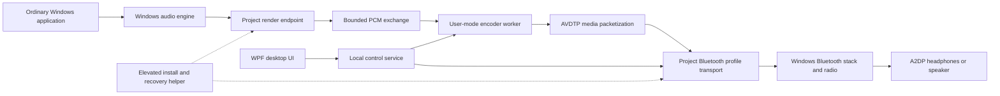

# System design

Status: proposed batch 1 design, 2026-10-21. Component boundaries and invariants guide feasibility work; driver binding, endpoint implementation, buffer mechanics, numeric limits, and wire layouts are not validated or frozen. See [requirements](01-project-requirements.md), [security](11-security.md), and [open questions](defect-risk-register.md).

## End-to-end flow

The endpoint delivers PCM to the project; it is not a loopback recorder relying on the inbox A2DP encoder. An APO alone is not assumed to add arbitrary Bluetooth codecs. A USB audio transmitter with its own firmware codecs is a different transport and outside this initial path.

Bluetooth profile interfaces and a sample endpoint exist, but they do not prove this combined design. [Microsoft Bluetooth stack](https://learn.microsoft.com/en-us/windows-hardware/drivers/bluetooth/using-the-bluetooth-driver-stack), [SysVAD sample](https://learn.microsoft.com/en-us/samples/microsoft/windows-driver-samples/sysvad-virtual-audio-device-driver-sample/)

## Components and ownership

| Component | Responsibility | Boundary / failure behavior |
| --- | --- | --- |
| Desktop UI | Select target, display capabilities/status, edit requested preferences, initiate explicit apply and recovery flows. | Standard user; no direct kernel handle or arbitrary administrative command. Closing UI does not interrupt a healthy stream. |
| Control service | Authenticate local session, own selected-device lease, validate requests, supervise worker, publish authoritative state. | Dedicated restricted identity where driver ACLs permit; minimum rights validated in M3. No general command execution. |
| Encoder worker | Consume bounded PCM, encode reviewed codec, packetize media, return timing/counters. | Isolated user-mode process, no administrative rights or driver-install capability. Its driver/data handle, if necessary, is narrowly delegated to the current stream. |
| Audio endpoint driver | Expose a Windows render endpoint; provide safe PCM exchange, format/state lifecycle, and silence/underrun behavior. | Minimum required kernel logic. Endpoint and profile transport may remain separate driver components; M4 resolves packaging. |
| Bluetooth profile transport | Own validated target binding/channels, enforce connection state and bounds, submit/cancel Bluetooth operations. | Kernel-facing transport through documented interfaces. Remote headset data and user-mode media are untrusted. |
| Install/recovery helper | Validate package and exact device identity, journal operations, install/bind/restore only project-related targets. | Explicit elevated operation, independently usable when UI/service/worker is broken. Never a long-lived generic privileged proxy. |

Windows continues to own pairing, radio transport, and out-of-scope profiles. Do not patch inbox binaries, bypass kernel protections, globally replace a Bluetooth stack, or bind broadly to every device to make a proof work. If safe per-target ownership is unavailable, stop at Q-001 and revise the plan.

## Connection and stream lifecycle

The following are application states, not a replacement for the normative AVDTP state machine. M1 pins the specifications; M3 implements protocol-specific transactions separately.

| State | Allowed progress | Failure / cancellation |
| --- | --- | --- |
| StandardDriver | Device uses the inbox path; project can inventory and show saved preferences. | No project streaming; installation is a distinct authorized operation. |
| Ready | Project binding validated, no channels/stream active. | Binding mismatch moves to RecoveryRequired. |
| Discovering | Query fresh capabilities for this device and connection generation. | Timeout/removal returns to Ready with capabilities marked stale/unknown. |
| Configuring | Intersect requested settings with actual remote and local capabilities; negotiate the explicit choice. | Unsupported/failed choice leaves stream stopped and explains why; no silent switch to another codec. |
| Streaming | Endpoint, worker, and transport share one current stream generation and negotiated configuration. | Disconnect, malformed state, deadline failure, worker death, or stop enters Stopping. |
| Stopping | Stop new work, cancel/drain outstanding operations, detach buffers/handles, publish stopped status. | A cleanup timeout isolates remaining resources and enters Faulted; never free memory while a callback can still access it. |
| Faulted | Playback stopped; diagnostic reason and last verified configuration retained. | Explicit retry after cleanup creates a fresh generation; bounded reconnect retries only for ordinary link loss. |
| RecoveryRequired | Binding/package state is uncertain, incomplete, or incompatible. | Block streaming/configuration; expose the independent recovery helper and readable recovery journal. |

One selected device and one controller session own the stream. On session logoff/ownership release, stop that user's stream and clear scoped handles before another user can acquire control. A new UI connection can inspect its own session but cannot seize another session's active stream.

Each connection has a generation identifier. Settings revision, operation correlation ID, and generation accompany internal work; late callbacks/events cannot mutate a newer connection. Reconnection always refreshes remote capabilities because headset mode, firmware, or multipoint state may have changed.

Changing codec/format while streaming is an explicit stop, negotiate, and restart operation in v1. Show saved/requested and active settings separately throughout. If apply fails, report the actual stopped/faulted state; a future retry is explicit. User selection of SBC is allowed; automatic cross-codec fallback is deferred.

Distinguish a Bluetooth link from A2DP readiness, endpoint availability and actual stream progress. Discovering a connected headset is not sufficient to label playback healthy. Expose the stalled stage and a safe next action for connected-but-silent reports (REF-002/003/007).

Track/video stop-start and app handoff can create new streams without disconnecting the headphones (REF-011). Drain or discard only at valid frame boundaries, reset the stream's media clock/sequence bookkeeping according to protocol, clear partial PCM/codec frames, and fence callbacks by stream as well as connection generation. For unchanged negotiated formats, restart without unnecessary link reconnect. For a supported format change, perform the explicit stop/reconfigure path. Validate left/right mapping and account for shared/exclusive routing and endpoint DSP independently of codec selection (RQ-019/025).

## Audio timing, buffers, and backpressure

The PCM contract is a research deliverable in M4-WP01. It must define formats, frame alignment, capacity, ownership transfers, read/write sequencing, cancellation, and lifetime. Do not expose arbitrary kernel pointers or accept caller-selected physical addresses. Do not claim a zero-copy/shared-memory mechanism before its safety and timing are measured.

Required behavior:

- Every queue has a finite configured capacity and a documented byte/frame/time interpretation. Buffer counts, integer conversions, and queue depth are validated on both sides.
- Kernel callbacks do bounded work and never wait for UI, file access, network access, or codec computation. Codec modules remain user-mode.
- Pacing follows a documented monotonic-clock/sample-clock strategy. Audio timestamps describe frame positions; wall-clock changes cannot stretch queue deadlines.
- Encoder output is limited by negotiated codec rules and actual transport MTU. Fragmentation, sequence/timestamp handling, and any resampling are explicit tested algorithms.
- When a producer outruns downstream processing, no queue grows indefinitely. Stop/suspend and report a stream fault if the measured deadline policy cannot be met; do not drop arbitrary encoded bytes or keep playing increasingly stale audio.
- During initial endpoint integration, underrun produces format-correct silence where appropriate at the endpoint boundary and an observable underrun event. Sending silence over Bluetooth still requires a live negotiated stream and valid codec frames.
- Avoid using a general JSON/named-pipe control stream for PCM or high-rate media. Choose the bounded data exchange in the M3/M4 ADRs; use buffered control IOCTLs where suitable for small messages.

Numeric capacities, enqueue budgets, reconnect backoff, and timeouts must be chosen and documented before their implementation packages. They are not arbitrary constants to be guessed by an implementing agent. M4 records measured settings; M7 locks beta thresholds from the baseline.

## Configuration and availability model

Keep separate fields for OS/inbox observations, remote-advertised capabilities, locally implemented codecs, reviewed distribution eligibility for the installed build, requested preferences, negotiated active settings, and freshness. An unavailable capability query is unknown, not an empty capability set or an assertion that a device lacks the codec.

Apply only the intersection of actual remote support, tested implementation support, and the installed build's enabled codec set. Distribution review is a build/release decision; it is not an activation check or remotely revocable playback license.

Display Windows PCM format, active A2DP/HFP profile, negotiated codec/transport format, selected microphone and transport owner as separate observations (RQ-026). A Windows 24-bit/96 kHz setting, no entry in a general decoder inventory, or a subjective listening impression does not establish the active Bluetooth codec. For a USB audio transmitter, show firmware-owned transport outside this driver path rather than offering an ineffective codec installation. Do not silently disable headset or standalone microphones to force A2DP; explain profile transitions using SRC-001 rather than conflicting community explanations.

V1 quality selection is manual (RQ-023). A later opt-in adaptive mode must have measurable signals, a within-codec quality floor, downgrade/recovery hysteresis, user-visible reasons and recovery of the saved manual setting when disabled. Missing/stale telemetry cannot justify aggressive quality reduction. Gate it separately; REF-013 is a regression scenario, not proof of a particular algorithm bug.

Preferences are per OS user and device. The privileged installation journal is machine-wide and separately protected. Settings corruption falls back to conservative defaults for editable preferences while displaying a warning; it never invents a valid active state or triggers a binding change. An unsupported newer settings version is not overwritten. Batch 2 specifies paths, schema/migrations, and atomic-write behavior.

## Lifecycle, coexistence, and recovery

| Trigger | Required handling | Proof |
| --- | --- | --- |
| Headphones disconnect / radio removal | Advance generation, stop accepting data, cancel pending I/O, release scoped handles, invalidate active/capability data. | M3/M4 removal and reconnect tests. |
| Sleep/resume | Quiesce work on suspend; validate binding/device and requery before restarting. Never reuse pre-suspend channel handles. | M4/M7 power tests. |
| Worker crash | Driver detects stream-owner loss, stops/cleans work, clears active state. Supervisor may restart only after bounded cleanup. | M4 failure injection. |
| UI crash | Healthy audio continues; a new authorized UI resynchronizes using a full state snapshot. | M6 lifecycle check. |
| Control service failure | Worker/driver terminate orphaned control/data leases; no unbounded autonomous retries. Recovery helper remains available. | M7 supervisor/crash checks. |
| Microphone/HFP transition | Respect Windows profile ownership. Stop/suspend project A2DP when required; report actual mode. No stereo-plus-microphone promise. | Q-003, M4-WP03. |
| AVRCP volume/playback | Preserve/test inbox behavior where feasible; capability and failure are visible, not assumed. | M4 coexistence matrix. |
| Install/update interruption | Recover using recorded prior binding and operation steps; validate current state rather than replaying unsafe changes. | M7/M8 recovery tests. |

Automatic recovery means safe cleanup and bounded restart of an existing project stream, not automatic elevated driver rebinding. Restoring the inbox path is a distinct privileged operation with validated target identity. Recovery is not complete until playback works again on that path; a successful installer exit is insufficient.

Persist intended owner and last observed binding separately from codec preferences. A mismatch after reboot/update/reconnect produces an ownership-drift diagnostic; no automatic privileged takeover (RQ-021). Independent recovery checks target endpoint enumeration/playback and non-target speakers/microphones immediately and after reboot. Installer progress/watchdog state and safe cancellation boundaries belong to the protected journal, not an optimistic UI timer (RQ-020/022).

Record endpoint identity and routing/DSP attachments around bind/restore/update. Prefer stable identity where feasible; otherwise invalidate stale handles/preferences through an explicit mapping and guide app/EQ/APO reattachment. Do not rewrite other applications' configuration or infer channel corruption solely from a listening report (RQ-025).

## Measurements and release evidence

Track negotiated format, encoded byte counts, submitted/completed packets, queue duration/depth, local errors, underruns, worker deadlines, and resources if the selected interfaces support them. Distinguish encoded bitrate from observed throughput. RF strength/retransmissions and end-to-end latency may be unavailable; never infer them from a UI slider.

A driver-side configuration record plus independent decoded/captured negotiation evidence demonstrates codec selection. Use permitted protocol capture or an independent instrumented receiver where available; pair it with audible playback/channel checks. If independent evidence is unavailable, keep the codec-verification gate open rather than silently lowering it to a dashboard screenshot.

M3 proves the Bluetooth path with a controlled source. M4 proves the Windows endpoint path. M5 proves LDAC. M7 adds stress and compatibility data; M8 qualifies the signed package. Every result records exact commits, tool versions, security configuration, OS, adapter/driver, headphones/firmware, parameters, method, and limitations.
